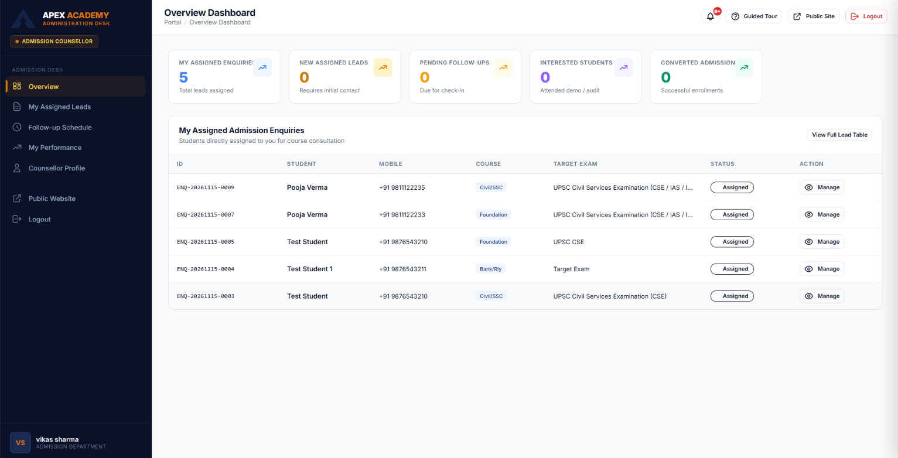

# APEX ACADEMY 🎓
### Smart Coaching Institute Website & Management Portal

APEX ACADEMY is a modern, responsive coaching institute website with an integrated student enquiry, counselling booking, and institute management system.

The project demonstrates how a coaching institute can manage student enquiries, coordinate counselling sessions, handle follow-ups, and monitor institute activities through dedicated administrative portals.

---

## 🌐 Live Demo

**Website:** [Add Your Live Website URL]

**GitHub Repository:** [https://github.com/ansh0014112/Apex-Academy-]

---

## 📌 Project Overview

APEX ACADEMY is designed to provide a complete digital experience for both students and institute administrators.

Students can explore courses, submit admission enquiries, and request counselling appointments.

Institute staff can manage enquiries, communicate with students, schedule follow-ups, manage counselling bookings, and monitor institute activities through role-based dashboards.

---

## ✨ Key Features

### 1. Public Website
- Modern and responsive website design.
- Institute introduction and course information.
- Student admission enquiry forms.
- Counselling appointment booking.
- Date and available time-slot selection.
- Responsive layouts for mobile, tablet, and desktop.

### 2. Super Admin Dashboard
- Institute-wide administrative overview.
- Counsellor account management.
- Staff role and department management.
- Counsellor workload monitoring.
- Admission and counselling activity tracking.
- Institute analytics and reports.
- Follow-up task monitoring.

### 3. Admission Counsellor Portal
- Student admission enquiry management.
- Lead status updates.
- Internal counsellor notes.
- Student communication history.
- Follow-up scheduling and management.
- Admission progress tracking.

### 4. Academic Counsellor Portal
- Counselling appointment management.
- Student booking details.
- Counsellor availability management.
- Appointment scheduling.
- Academic counselling follow-ups.

### 5. Communication System
- Gmail API-based email notifications.
- WhatsApp Cloud API integration (subject to provider configuration).
- Communication history.
- Automated notification workflows.
- Shared institute communication identity.

---

## 👥 User Roles

| Role | Responsibilities |
|---|---|
| Super Admin | Institute-wide management and administration |
| Admission Counsellor | Admission enquiries, student communication and follow-ups |
| Academic Counsellor | Counselling bookings, academic guidance and availability |

---

## 🛠️ Technology Stack

| Technology | Purpose |
|---|---|
| HTML5 | Website structure |
| CSS3 | Styling and responsive design |
| JavaScript | Frontend functionality |
| Supabase | Backend and database |
| PostgreSQL | Database management |
| Supabase Auth | Authentication |
| Supabase Edge Functions | Server-side operations |
| Netlify | Website hosting |
| Git & GitHub | Version control |

Additional integrations:
- Gmail API (OAuth 2.0)
- Meta WhatsApp Cloud API

---

## 📸 Project Screenshots

Explore the different sections of APEX ACADEMY.

### 1. Public Website

)

### 2. Courses & Programs

)

### 3. Admission Enquiry Form

)

### 4. Counselling Booking System

)

### 5. Super Admin Dashboard

)

### 6. Admission Counsellor Portal

![Admission Counsellor Dashboard]

### 7. Academic Counsellor Portal

)

---

## ⚙️ Project Setup

### Step 1: Clone Repository

```bash
git clone https://github.com/ansh0014112/Apex-Academy-